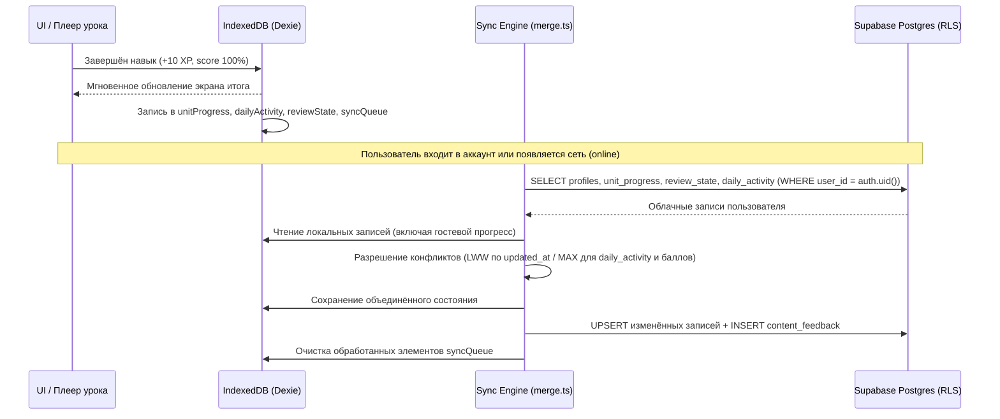

# Архитектура локальной БД и облачной синхронизации (SYNC.md)

В проекте «Türkçe Duo» первичным источником правды для пользовательского интерфейса всегда выступает **локальная база данных в браузере (IndexedDB через `Dexie`)**. Это гарантирует мгновенный отклик интерфейса (0 мс ожидания сети при переходе между экранами и завершении уроков) и 100% работоспособность в гостевом и офлайн-режимах.

Облачная база данных **Supabase PostgreSQL** используется для резервного копирования прогресса и синхронизации между устройствами авторизованного пользователя.

---

## 1. Таблицы локальной БД (`src/lib/db/dexie.ts`)

В `TurkceDuoDatabase` (IndexedDB `TurkceDuoDB`, версия 1) хранятся 6 таблиц:

| Таблица Dexie | Первичный ключ | Назначение | Соответствие в Supabase |
|---|---|---|---|
| `localProfile` | `id` (`'current'`) | Текущий профиль, выбранный курс (`tr`/`en`), дневная цель (`10`/`20`/`30` XP) | `public.profiles` |
| `unitProgress` | `unitId` | Прогресс по словам и лучшие баллы (`0..100`) по 4 навыкам (`speaking`, `listening`, `writing`, `reading`) | `public.unit_progress` |
| `reviewState` | `unitId` | Текущий шаг интервального повторения (`1 → 3 → 7 → 14` дней) и дата `dueAt` | `public.review_state` |
| `dailyActivity` | `day` (`YYYY-MM-DD`) | Заработанный за день XP, количество пройденных уроков и секунд практики | `public.daily_activity` |
| `syncQueue` | `++id` | Офлайн-очередь несинхронизированных изменений (дедуплицируется по `table + recordKey`) | — (служебная очередь) |
| `cachedUnits` | `unitId` | Локальный кэш JSON открытых юнитов для гарантированной работы без сети | — (кэш контента) |

---

## 2. Триггеры синхронизации

Функция `synchronizeWithCloud()` (`src/lib/sync/engine.ts`) запускается автоматически в следующих 5 точках:

1. **При входе или регистрации (`SIGNED_IN` в Supabase Auth):**
   Все данные, накопленные пользователем в гостевом режиме в `Dexie`, автоматически сливаются с его облачным профилем и отправляются в Supabase.
2. **При восстановлении сети (`window.addEventListener('online')`):**
   Как только устройство выходит из офлайна, накопленная очередь `syncQueue` выгружается в облако.
3. **При возврате пользователя на вкладку (`document.addEventListener('visibilitychange')`):**
   Когда `document.visibilityState === 'visible'`, приложение подтягивает свежие изменения, сделанные на другом устройстве (например, на телефоне).
4. **Периодически (каждые 60 секунд):**
   При открытой активной вкладке и наличии авторизованной сессии.
5. **Сразу после завершения навыка/урока или изменения настроек:**
   Запись сначала атомарно сохраняется в `Dexie` и `syncQueue`, после чего в фоне вызывается неблокирующий `synchronizeWithCloud()`.

---

## 3. Диаграмма потока синхронизации и переноса гостевого прогресса

---

## 4. Правила разрешения конфликтов (`src/lib/sync/merge.ts`)

В соответствии с разделом 4.2 мастер-промпта:

1. **`profiles` и `review_state` — Last-Write-Wins (LWW) по `updated_at`:**
   - Сравниваются ISO-8601 метки времени `local.updatedAt` и `remote.updatedAt`.
   - Побеждает запись с более поздним `updated_at`.
2. **`daily_activity` — Покомпонентный максимум (`GREATEST` / `Math.max`):**
   - Если пользователь занимался в один и тот же календарный день `YYYY-MM-DD` на двух устройствах (или часть дня офлайн как гость, а затем вошёл в существующий аккаунт), для поля `xp`, `lessons` и `seconds` берётся максимум:
     - `xp = Math.max(local.xp, remote.xp)`
     - `lessons = Math.max(local.lessons, remote.lessons)`
     - `seconds = Math.max(local.seconds, remote.seconds)`
     - `updatedAt = max(local.updatedAt, remote.updatedAt)`
3. **`unit_progress` — Сохранение лучших результатов + новейший `updated_at`:**
   - `wordsDone = local.wordsDone || remote.wordsDone`
   - Для каждого из 4 навыков (`speakingBest`, `listeningBest`, `writingBest`, `readingBest`) берётся `Math.max(local, remote)` (с учётом `null`).
   - Для `completedAt` сохраняется самая ранняя непустая дата завершения юнита, а для `updatedAt` — самая свежая метка времени.
4. **`content_feedback` — Append-only (`INSERT`):**
   - Сообщения «Сообщить об ошибке» накапливаются в `syncQueue` и при наличии авторизованной сессии отправляются через `INSERT` в `public.content_feedback`, после чего удаляются из локальной очереди.
